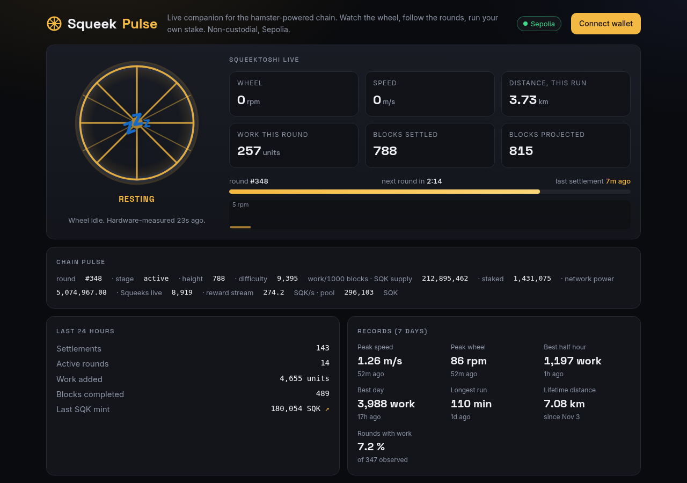
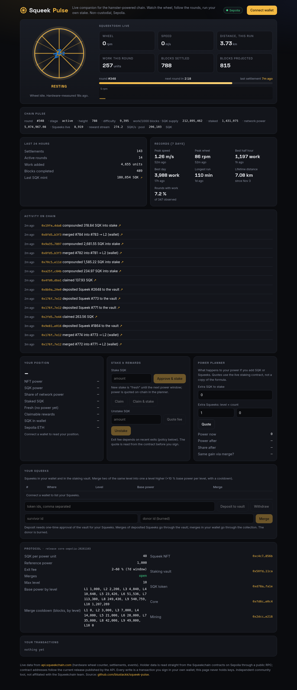

# Squeek Pulse

Live companion and non-custodial holder tool for [Squeekchain](https://squeekchain.com), the hamster-powered chain, on Sepolia.

**https://squeek.blu-stack.com**



## What it shows

### Squeektoshi live
The wheel at the top turns at the speed the hardware counter reports, and sleeps when Squeektoshi rests. Polled every 5 seconds from the public API:

- wheel rpm, speed and distance from the signed hardware counter
- work units in the open round, blocks settled vs. blocks projected
- round number and a countdown to the next round (10-minute rounds, from the core contract's genesis timestamp)
- time since the last settlement, linked to the Sepolia transaction
- a rolling 5-minute rpm sparkline

### Chain pulse, last 24 hours, records
Round and stage, block height, difficulty, SQK supply, total staked, network power, live Squeeks and the reward stream; a 24-hour settlement summary with the last SQK mint; and 7-day records (peak speed, peak rpm, best half hour, best day, longest run, lifetime distance).

### Activity on chain
A live feed of protocol events: stakes, claims, compounding, vault deposits and withdrawals, merges, settlements, mining checkpoints and Squeektoshi's own milestones (speed records, distance milestones). Each entry links to the transaction.

### Your position and your Squeeks
Connect a wallet (MetaMask, Rabby, any injected EIP-1193 wallet) and the page reads your position straight from the contracts:

- NFT power and SQK power (`accountPower`), share of network power, staked and fresh principal (`stakeOf`), claimable rewards, balances
- every Squeek you hold in wallet or in the staking vault, found from `Transfer` and `Deposited` logs (via the Blockscout log index, because public Sepolia RPCs prune old logs) and confirmed on-chain with `ownerOf` / `depositor`; each row shows level, base power and merge cooldown
- **Power planner**: what adding SQK or Squeeks does to your power, quoted with `quotePower` and `basePower` on the live staking contract rather than a copied formula

### Actions
Each one is a transaction you sign in your own wallet: approve and `stake`, `claim`, `claimAndStake`, `unstake` with an on-chain `quoteUnstake` fee preview and a 5 % fee ceiling, `deposit` / `withdraw` Squeeks to and from the vault, and `merge` (collection) or `mergeDeposited` (vault) with level, custody and cooldown checks before you sign.



## How it works

One static HTML file, no build step, no backend, no keys, no analytics.

- Live data: `api.squeekchain.com/v1` (`/status`, `/economy/state`, `/core`, `/settlements`, `/measurement/stats`, `/events`).
- Contract addresses are **not hardcoded**: the page reads the current release from `/economy/state` (`deployment.components`) and binds to those contracts, so it follows redeployments. Release `core-sepolia-20261103` is only the fallback if the API is down.
- Reads go through the public Sepolia RPC at publicnode with ethers v6 (cdnjs). Writes go through your injected wallet.
- Everything rendered from the API is escaped; addresses are validated before they are linked.
- Respects `prefers-reduced-motion`, keyboard focus is visible, works at phone width.

## Run locally

```
python3 -m http.server 8000
```

Then open http://localhost:8000.

## Independent community tool

Not affiliated with the Squeekchain team. MIT licensed.

squeekchain-project: 9f0a23a3-c025-4f7a-a02d-ed2a7a36dca3
